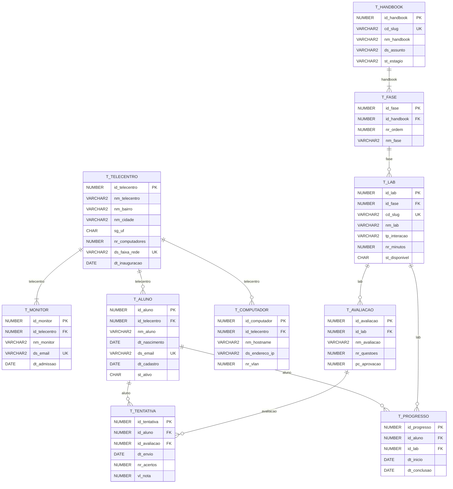

# Modelo do banco do OpenLabs no Telecentro

Gerado por `database/gerar.mjs` a partir de `packages/database-domain`. É um diagrama de
**conferência**: o diagrama entregue na disciplina é o do Oracle Data Modeler (veja
`README.md`, seção 2). Os dois têm de mostrar as mesmas tabelas e ligações.

