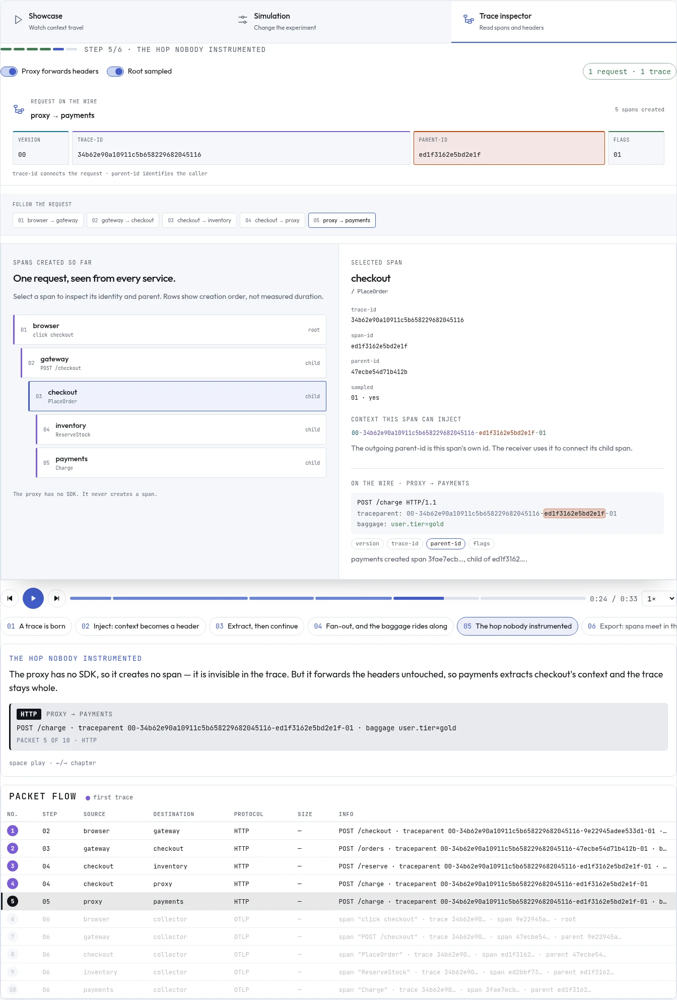
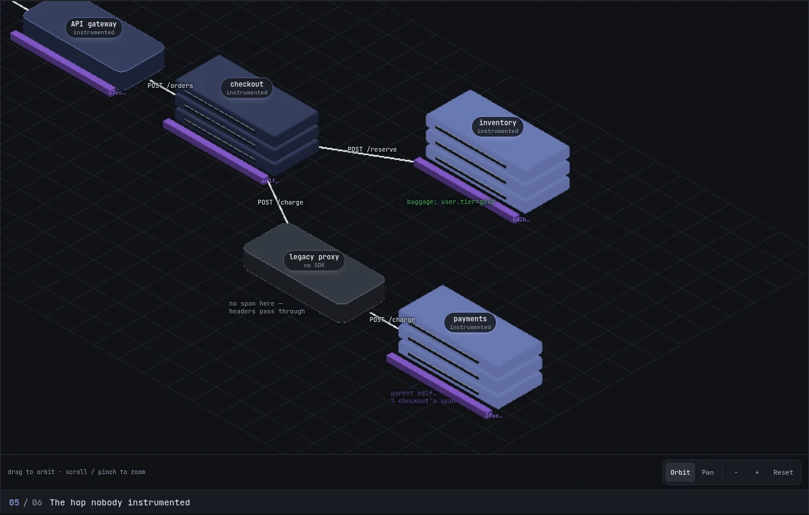
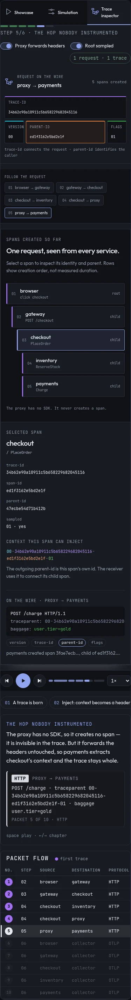
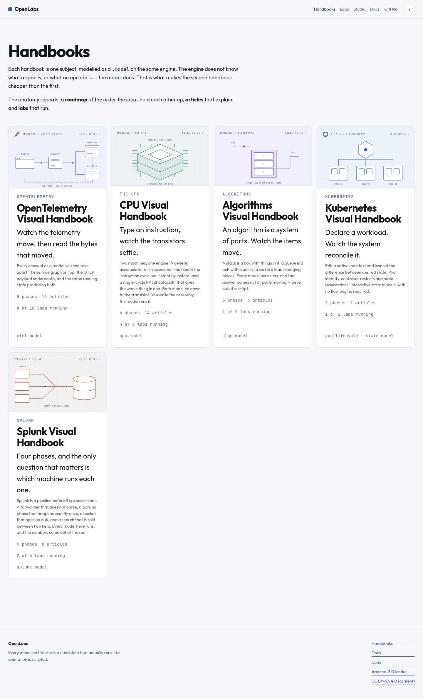

# OpenTelemetry: bancada de traces e navegação 3D

Primeira iteração visual de 2026-11-03, com foco no lab `hard-context-and-baggage`.
As referências visuais mencionadas no pedido ainda não foram recebidas.

## Comportamento entregue

- Showcase, Simulation e Trace inspector compartilham o relógio e as opções do experimento. Trocar de aba preserva o instante; o hash permite abrir um modo diretamente.
- O header mostra os quatro campos do contexto da requisição em trânsito. O seletor de saltos pausa o filme no envio escolhido, incluindo a chamada ao proxy sem SDK.
- O inspetor permite selecionar spans, conferir a identidade e o pai e comparar o contexto de entrada com o que o span pode injetar. Descartar headers cria outra raiz; sampled = 0 deixa a exportação vazia.
- As linhas representam ordem de criação, sem inventar durações de spans. O modelo continua sendo uma topologia determinística, não um backend de telemetria real.
- O catálogo de formas ganhou janela/monitor, servidor e roteador. A topologia do contexto usa essas formas; o Collector usa o rack existente. Os detalhes ficam nas bordas para preservar os rótulos na vista plana.
- Orbit, pan, zoom, reset e pinça funcionam no palco 3D. Há controles de teclado. As barras de controle ficam fora do desenho, e o palco cresce no celular.
- Cada handbook ganhou uma ilustração do seu mecanismo e as cores do seu próprio tema. Marcas oficiais de OpenTelemetry e Kubernetes têm origem registrada em `apps/site/public/brands/README.md`. O índice também passou a importar o cromo compartilhado de navegação e rodapé.

## Validação

- `pnpm test`: 133 arquivos, 1.622 testes aprovados.
- `pnpm typecheck`, `pnpm boundaries`, `pnpm catalogo` e `pnpm build` aprovados.
- Playwright: 10 casos do lab (desktop e Pixel 7), incluindo mudança de headers, continuidade do relógio, outra raiz, sampled = 0, zoom/pan/reset e pinça via dois toques reais do CDP.
- Outros 12 casos de navegador cobrem os handbooks, a landing e o showcase do Collector.
- `PW_CHROMIUM=/usr/bin/chromium pnpm qa:labs --only=labs/hard-context-and-baggage/`: duas auditorias sem falha nem alerta. A vista inicial de sequência ficou em 59 fps e p95 de 17 ms, com CPU a 4×, em desktop e celular.
- As 74 capturas da auditoria por capítulo/vista/modo foram abertas em folhas de contato. A revisão levou à remoção de detalhes sobre os textos e dos controles sobre a cena. Inspeção adicional em temas claro/escuro e largura de 390 px. O indicador de status teve contraste medido de 9,27:1 no claro e 6,47:1 no escuro.

## Limitação de desempenho: 3D por software

O resultado da vista inicial **não mede a animação 3D**. Uma sonda separada abriu
Iso, limitou a CPU a 4× e mediu 3,5 s do capítulo de fan-out, em Chromium/WebGL2
por software, com viewport de 1366×1000:

| estado | rAF médio | p95 do intervalo |
|---|---:|---:|
| cena desta iteração com materiais físicos e sombras | 1,5 fps | 933 ms |
| caminho para renderização por software (duas execuções) | 11,9–12,2 fps | 133–150 ms |

Esse caminho detecta SwiftShader/llvmpipe/softpipe, usa iluminação difusa e
sombras de contato, desliga mapas de sombra e MSAA do alvo intermediário e
limita a resolução do canvas a 0,75×. Rótulos e controles continuam em DOM, na
resolução da tela. Dispositivos com GPU conservam os materiais físicos,
sombras e DPR de até 2.

**Ainda há pendência:** o p95 de 133–150 ms excede a referência de 120 ms para
interação. A medida é de callbacks de rAF, não de quadros apresentados pela
GPU. Não foi possível medir uma GPU física neste ambiente. O próximo passo é
medir o custo de desenho por objeto e consolidar malhas/materiais no caminho
por software; não tratar a auditoria da sequência como aprovação de performance
3D. A dívida do zoom profundo em SVG continua descrita no relatório de
[desempenho anterior](2026-11-03-performance.md).

Para reproduzir a sonda, sirva o build de produção na porta 4399 e execute:

```sh
pnpm --filter @ovh/site preview --host 127.0.0.1 --port 4399
# Em outro terminal; PW_CHROMIUM é opcional fora deste ambiente.
PW_CHROMIUM=/usr/bin/chromium pnpm --filter @ovh/site exec node qa/iso.mjs
```

`QA_URL` permite apontar a sonda para outro host ou caminho-base. O resultado
fica em `apps/site/qa-report/iso.json`.

## Capturas desta iteração

As capturas abaixo usam o caminho por software disponível neste ambiente.








